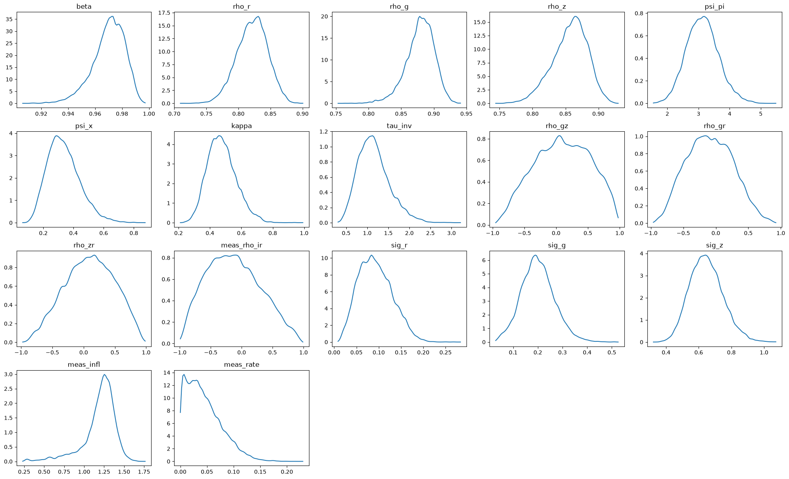
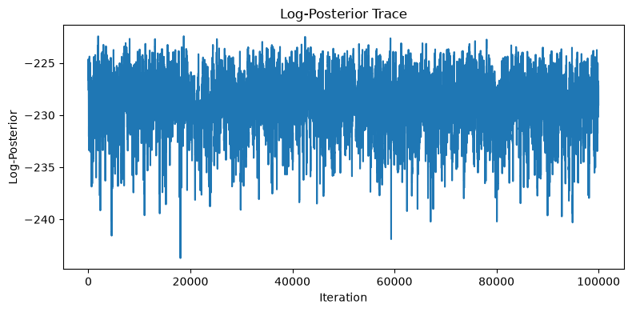

---
tags:
    - guide
---

# Estimation Guide

??? tip "TL;DR"
    Refer to [this](../assets/param_estimation.ipynb) notebook for an example parameter estimation workflow.

???+ warning "Read the Quickstart Guide"
    This guide only handles the estimation process and is written assuming the reader has some familiarity with the core DSGE API (i.e. `parse_config`, `solve_model`, `SolvedModel` etc.). It is strongly recommended to at least have read the [Quickstart Guide](./quickstart.md) before working with parameter estimation.

This guide walks through the parameter estimation workflow of `SymbolicDSGE` using an example setup and an MCMC sampling based Bayesian Estimation setup.

We will cover:

- How priors are built (and why transforms matter)
- How to run MCMC through `Estimator`
- What outputs to expect from the process

## Parse Configs and Compile

```python
from SymbolicDSGE import parse_config, solve_model, Estimator, LinearKalman
from SymbolicDSGE.utils import FRED
from SymbolicDSGE.utils.math_utils import HP_two_sided, annualized_log_percent
from SymbolicDSGE.bayesian import make_prior

from typing import cast

import numpy as np
import pandas as pd

model = parse_config("../../MODELS/POST82.yaml")
```

???+ note "Data Input"
    The companion notebook retrieves FRED data, constructs the POST82 gap variables, and supplies inflation and the policy rate as level observables. It sets `FRED_KEY` in the environment or a `.env` file. This guide assumes the resulting `observed` `DataFrame` is already available.

## Prior Specification

Priors are objects we use to define our "prior beliefs" about a parameter. To give a quick example, take a model parameter $\beta$ (discount factor).
In theory, $\beta$ can be any number such that $\beta \in (0,1)$. However, we know that $\beta$ should reside more or less within $0.95 \pm 0.05$. We can use a prior on $\beta$ to penalize the optimizer when it strays further away from our belief to ensure our parameter estimations remain economically interpretable. In `SymbolicDSGE` priors can be defined with the `make_prior` function as such:

```python
beta_prior = make_prior(
    distribution="beta", # (1)!
    parameters={"a": 200 * 0.971, "b": 200 * 0.029}, # (2)!
    transform="logit", # (3)!
)
```

1. Distribution in parameter space.
2. Parameters of the distribution. This yields a Beta distribution with heavily concentrated probability mass around the mean of 0.971.
3. Transform function mapping the parameter space to the unconstrained optimizer space. Here, `logit` maps `(0, 1) -> (-inf, inf)`.

The prior specification defines `Distribution`s such that the optimizer can interact with the distribution object on the unconstrained space.
For example, in order to optimize in an unbounded search space $\R = (-\infty, \infty)$ we can use any distribution of our choosing regardless of the bounds,
as long as we specify a `Transform` that maps the distribution support $(a, b) \mapsto \R$. We then rely on the `Transform` objects to apply a "Change of Variables" to produce the unbounded search input. The `Transform` will also be responsible for inverting the optimizer output into the parameter space ($\R \mapsto (a,b)$) we wish to search over. To give a concrete example, a logit transform for example would map $(0,1) \mapsto\R$ in the forward direction. In this scenario the inverse logit would precisely do the opposite $ inv(Z) \to X, \, X \in (0,1) $.

Using `make_prior` we can define individual priors for each parameter we wish to estimate:

```python
estimated = {
    # (0, 1)
    "beta": make_prior(
        "beta",
        parameters={"a": 200 * 0.971, "b": 200 * 0.029},
        transform="logit", # (1)!
    ),
    "kappa": make_prior(
        "gamma",
        parameters={"mean": 0.58, "std": 0.1},
        transform="log", # (2)!
    ),

    ...,

    "Q_corr": make_prior( # (3)!
        "lkj_chol",
        transform="cholesky_corr",
        parameters={"eta": 2.0, "K": 3},
    ),
    "sig_r": make_prior(
        "gamma",
        parameters={"mean": 0.18, "std": 0.1},
        transform="log",
    ),
    ...,
}
```

1. `logit` does not require parameters and (inverse) transforms to (0, 1)
2. `log` maps real numbers to positive reals without requiring parameters.
3. `Q_corr` and `R_corr` are block estimations requiring the complete correlation matrix to be parameterized in the config. The `lkj_chol` distribution and `cholesky_corr` are necessary to produce a valid correlation block and are enforced.

## Estimator Setup

The `Estimator` object allows acces to `mle`, `map`, and `mcmc` estimation routines after being initialized with routine-invariant information.

```python
est = Estimator(
    config=model,
    y=observed.loc[observed.index >= "1984-01-01", :], # (1)!
    observables=["Infl", "Rate"], # (2)!
    filter=LinearKalman(jitter=1e-8), # (3)!
    estimated_params=estimated,  # (4)!
    ss_seed=[0.0, 0.0, 0.0, 0.0, 0.0]
)
```

1. Observed data we want to calibrate against
2. Which observables to use from the model specification. If not specified, all observables will be used. Number of columns in `y` must match the number of observables.
3. The filter used to compute the likelihood. Can be any of the [`Filter`](../documentation/filters/index.md) subclasses (that's suitable with the model being supplied).
4. Dictionary of `{name: Prior}` or a list of names for the unpriored case.

## Running the Estimation

After instantiating the `Estimator` any of the three estimation routines can be run, each with their own parameterization.

```python
res = est.mcmc(
    n_draws=100_000,  # (1)!
    burn_in=10_000,  # (2)!
    thin=1,  # (3)!
    random_state=0,  # (4)!
)
```

1. Number of retained draws.
2. Burn-in iterations.
3. Keeps every `thin`-th draw. Specifying a `thin` > 1 discards some samples and is commonly used to prevent autocorrelation.
4. Seed the draws for reproducibility. If `None`, the draws are not seeded.

```text
MCMC sampling concluded in 5.78 seconds with 19034.66 iterations per second.
[Estimator:mcmc] BK stability warnings encountered during search: 0
```

???+ note "Filter Selection"
    Filter modes increase in capability and complexity as follows: `LinearKalman` < `ExtendedKalman` < `UnscentedKalman`. Linear doesn't support any non-linearities in the model (transitions and measurements). Extended allows for non-linearities in measurements, but not in transitions. Unscented, which is by far the slowest,
    requires a non-linear (`order>=2`) solution and supports non-linearities in both transitions and measurements. In general, it is recommended to use the simplest possible filter mode that is compatible with a given model. (Note that `ExtendedKalman` on a linear model is equivalent to `LinearKalman` but slower.)

???+ note "Draw Count Calculation"
    `n_draws` directly lets you specify the Effective Sample Size (ESS) you want to retain. Given `n_draws`, `burn_in`, and `thin`, the total number of draws an estimation routine will perform is `n_draws * thin + burn_in`.

## Inspecting the Results

The estimation will return a `MCMCResult`, `MLERestult`, or `MAPResult` depending on the specified method. Alongside other metadata, these objects report:

- Order of parameters in the sample array(s)
- Each sample drawn (if multiple are drawn)
- Log posterior of each retained sample

The `MCMCResult` case will be expanded here, but you can refer to the [`Estimator`](../documentation/Estimator.md) reference page to find out exactly what is available in each result type.

```python
point = res.posterior_point("mean", digits=3)  # (1)!
ess = res.ess  # (2)!
ess_ps = res.ess_per_second  # (3)!
mcse = res.mcse  # (4)!
hpd = res.hpd_intervals(alpha=0.05, digits=3)  # (5)!

# Summary containing above statistics
print(res.summary(alpha=0.05, digits=3))
```

1. `posterior_point` reduces the posterior distribution to a single point estimate.
`mean` is the posterior mean and the default. `map` is the empirical MAP estimate (the log-posterior maximizing point in the sample), and `last` is the last sample drawn.
2. `ess` is the Effective Sample Size (ESS), it is a autocorrelation based measure of how many draws in a sample provided unique information. The figures are calculated for retained draws.
3. `ess_per_second` is the `ess` divided by the post-warmup runtime of the MCMC kernel. It measures the efficiency of the sampler, tweaking the sampler's hyperparameters to optimize for `ess` or `ess_per_second` is generally advisable.
4. `mcse` is the Monte Carlo Standard Error (MCSE), it is the monte carlo equivalent of the standard errors and defines the uncertainty around the mean of the posterior distribution. Alternatively `mcse_quantile(q)` is a MCSE approximation for the unceertaintyaround the `q`-th empirical quantile of the posterior distribution.
5. Highest Posterior Density (HPD) intervals are similar to confidence intervals, but calculate the region of highest density in the posterior distribution. For example, the 95% HPD interval (`alpha=0.05`) is the smallest interval containing 95% of the posterior mass.

```text
              mean    std       ess  ess_per_second   mcse     hpd (α=0.05)
beta         0.970  0.012  1080.967         207.665  0.000   (0.946, 0.991)
rho_r        0.821  0.024   609.137         117.021  0.001   (0.775, 0.867)
rho_g        0.879  0.022   773.308         148.560  0.001    (0.837, 0.92)
rho_z        0.857  0.027   849.221         163.144  0.001   (0.801, 0.903)
psi_pi       3.128  0.514   748.122         143.722  0.019    (2.14, 4.165)
psi_x        0.335  0.107  1129.949         217.075  0.003   (0.147, 0.549)
kappa        0.476  0.091   962.902         184.983  0.003     (0.31, 0.66)
tau_inv      1.158  0.373   611.165         117.411  0.015   (0.497, 1.915)
rho_gz       0.095  0.433   851.219         163.528  0.015  (-0.694, 0.871)
rho_gr      -0.089  0.351   787.493         151.285  0.013  (-0.751, 0.558)
rho_zr       0.093  0.390  1232.472         236.771  0.011  (-0.636, 0.815)
meas_rho_ir -0.124  0.429  1155.338         221.952  0.013  (-0.886, 0.672)
sig_r        0.093  0.037   420.354          80.754  0.002   (0.025, 0.164)
sig_g        0.201  0.067   540.395         103.815  0.003   (0.071, 0.335)
sig_z        0.647  0.102   927.601         178.202  0.003   (0.461, 0.856)
meas_infl    1.194  0.205   171.195          32.888  0.016   (0.716, 1.529)
meas_rate    0.045  0.033  1324.665         254.482  0.001     (0.0, 0.106)
```

## Other Fit Diagnostics (MCMC)

### Posterior Density Estimation

Each estimated parameter comprises a sampled distribution which can be treated as a marginal posterior distribution. The `MCMCResult.posterior_kde_plot` method uses standard Gaussian Kernel Density Estimation to visualize the posterior distributions of each parameter to scan for abnormalities such as multimodality, skewness, or other.

```python
res.posterior_kde_plot(grid_points=100) # (1)!
```

1. `grid_points` is the number of points to use in the KDE grid. More points yield a smoother curve, but take longer to compute. It's not recommended to use more than 1000 points, density estimation is computationally expensive and runtime can challenge the entire estimation process.



### Log-Posterior Trace

The log-posterior trace is a "time series" of the log-posterior, showing the log-likelihood of each sample drawn in-order. Inspecting this can tell us whether the sampling process was non-convergent, or whether the chain got stuck in a local optimum for a long time. The `MCMCResult.logpost_trace_plot` method can be used to visualize the log-posterior trace.

```python
res.logpost_trace_plot() # (1)!
```

1. The method produces a plot from the `MCMCResult.logpost_trace` array with no parameters required.



## Using the Estimated Parameters

All result classes provide a `apply_to(config)`  method that returns a new `ModelConfig` with the estimated parameters applied. For MCMC, we additionally need to specify the point estimate we want to use.

```python
estimated = res.apply_to(model, point="mean")  # (1)!
sol = solve_model(estimated, order=1)
```

1. `mean` is the default point estimate, but `map` and `last` are also available as in `posterior_point`.

## Practical Notes

???+ note "When to Use MLE vs MAP vs MCMC"
    - `MLE`: MLE is a so called "pure" estimation technique used if and only if we want the set of parameters that best fit the data; without imposing any other constraints.
    - `MAP`: MAP is similar to MLE in the sense that it returns a single set of parameters maximizing a given objective. However, MAP has prior beliefs in the objective function. Therefore, the maximization yields a result both respecting the plain likelihood and our beliefs regarding parameters.
    - `MCMC`: MCMC is a sampling method aimed to generate a posterior distribution using our prior beliefs and the likelihood. Effectively, MCMC samples multiple parameter sets sampled with respect to priors and computes their likelihood. In this case, we no longer have a maximization problem; we create a sampled distribution and use a point in said distribution as the parameters. This approach often yields more stable parameter compositions and allows more freedom regarding exactly which "point" to select as the parameters.

???+ warning "Estimating Components of Symmetric Positive Definite Matrices"
    The model config provides two covariance matrices specified with parameters for standard deviations and the correlation coefficients. These are `Q` and `R` explaining the covariance of shocks and measurement noise respectively. To ensure estimation of any component in these matrices yields a valid covariance matrix, there's logic implemented around estimation to transform these variables. It is recommended to estimate the correlation block of these marices together using the reserved estimation keys: `<R/Q>_corr`. Standard deviations are estimated as scalars.

    When the specification doesn't guarantee correct boundedness, MLE estimation ensures the positivity of standard deviations with a lower bound; MAP and MCMC use a log transform.
    Both sides use a CPC transform on correlation blocks to guarantee a valid correlation matrix; Importantly, this is not a priored transformation by default. The LKJ prior is a separate distribution that can be used for priored estimation routines. Estimation of correlation members as scalars is subject to a SPD matrix check and specifications that don't guarantee a valid correlation matrix will raise an error.

## Further Steps

More detailed information regarding estimation can be found via the references. Alternatively you can refer to [this](../assets/guide_notebook.ipynb) example notebook to see parameter estimation workflow used when generating the outputs for this guide.

???+ note "References"
    This guide focuses on solver-facing estimation flow. For API-level references, use:

    - [`Estimator`](../documentation/Estimator.md)
    - [`Prior`](../documentation/prior_spec/Prior.md)

[Download Guide Notebook](../assets/param_estimation.ipynb){ .md-button download="" }
