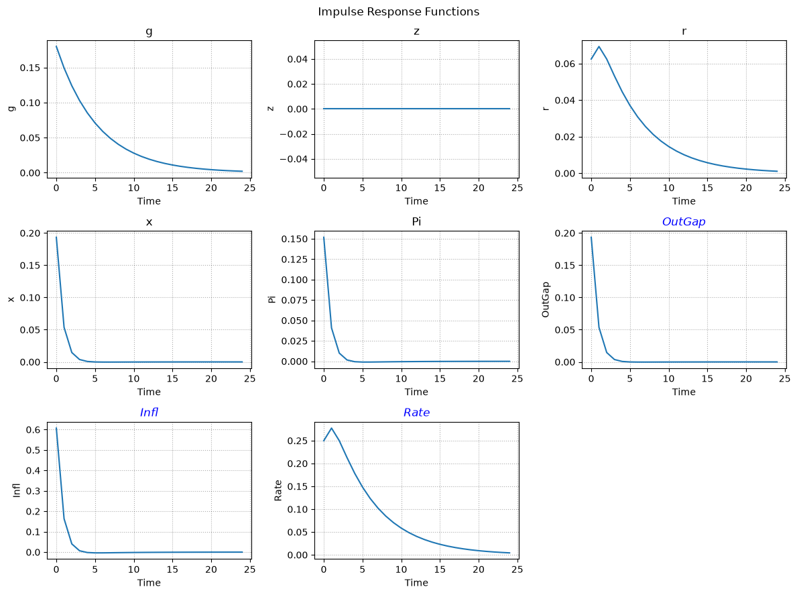
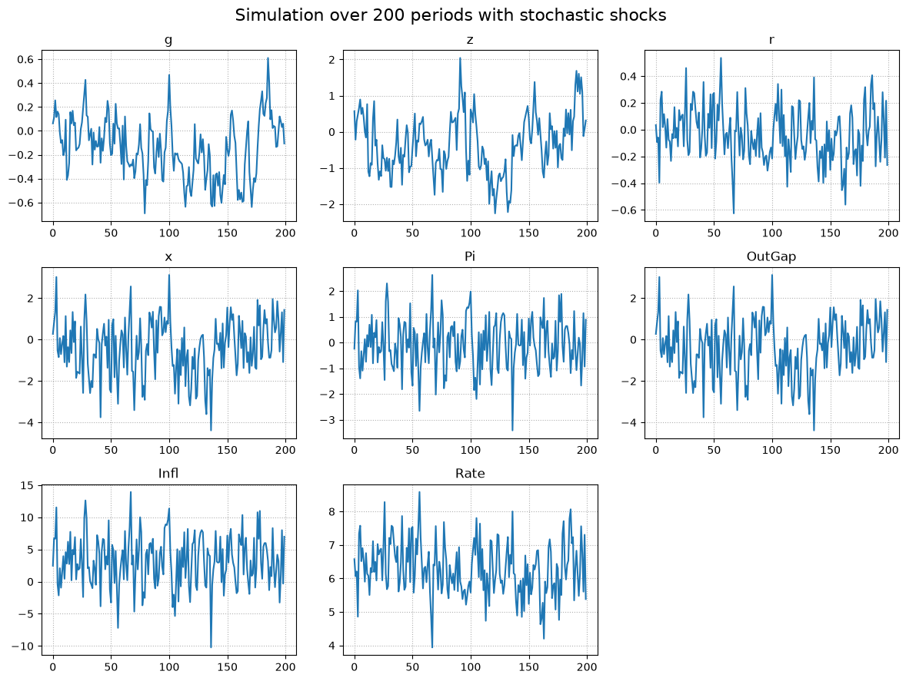

---
tags:
    - guide
---

# Quick Start Guide

??? tip "__TL;DR__"
    You can find a demonstration notebook [here](../assets/guide_notebook.ipynb).

This guide will follow the steps necessary to get from model parsing to simulation.
We will use a pre-defined config file (accessible in the [repository](https://github.com/GongJr0/SymbolicDSGE/)) `"MODELS/POST82.yaml"`.


## Reading Model Configuration

The configuration files are parsed by the `SymbolicDSGE.parse_config` function.

```python
from SymbolicDSGE import Shock, parse_config, compile_model, solve_model

from sympy import Matrix
from warnings import catch_warnings, simplefilter

from numpy import ceil, sqrt

import pandas as pd
import matplotlib.pyplot as plt

model = parse_config("../../MODELS/POST82.yaml")

with catch_warnings():
    # Equations in a sp.Matrix are deprecated, this is only used as a pretty print function
    simplefilter(action="ignore")
    mat = Matrix(list(model.equations.model.values()))
mat
```

This displays the parsed equations as `SymPy` objects. Variables are functions of time, and the configuration retains the equations through the `ModelConfig` interface.

## Compilation

Compilation converts the symbolic model to a numeric residual callback. It desugars longer leads and lags with auxiliary variables, derives the state and control layout from equation timing, and compiles the residual consumed by the first-order solver.

The regular solve function (see below) executes the compilation step automatically,
however compilation is by far the most expensive step in the solution process and there's a separate `compile_model(ModelConfig)` function to allow for multiple solves/estimation routines without re-compiling the model.

```python
compiled = compile_model(model)
```

???+ note "Variable Layout"
    The residual callback receives numeric forward, current, and previous variable vectors, the current shock vector, and the parameter vector. A variable that occurs at `t-1` is a state, and every other variable is a control. The compiler creates any auxiliary variables needed for longer lags or leads, then places all states before controls.

## Solution

The solution step takes steady-state values and optionally parameter calibrations to provide a `SolvedModel`.

```python
sol = solve_model(
    model,
    compiled=compiled,  # Optional
    parameters=None,  # None => use "calibration" from model config
    ss_seed=[0.0, 0.0, 0.0, 0.0, 0.0],
)

print("Is determinate ", sol.is_determinate)
print("Eigenvalues: ", sol.policy.eig.round(3))
```

`parameters=None` uses the calibration values from the model configuration. `is_determinate` indicates that the number of stable roots matches the model's state count. The returned `SolvedModel` retains the compiled representation, its calibration, and the policy solution.

<div class="annotate" markdown>
```
Is determinate:  True
Eigenvalues:  [0.28 +0.j 0.83 +0.j 0.85 +0.j 2.605+0.j 1.185+0.j] (1)
```
</div>
1. Eigenvalues stay complex because the ordered Schur solve makes the imaginary part meaningful here. The policy matrices are not: `sol.policy.p` and `sol.policy.f` are real, projected once inside the solve.

## Inspecting Model Dynamics

While we can check the matrices directly, we can also use the built-in methods `SolvedModel.irf` and `SolvedModel.transition_plot` to display the dynamics.

```python
irf_dict = sol.irf(
    T=25,
    shocks=["e_g", "e_z"],
    scale=1.0,  # shock = sigma_var * scale
    observables=True,  # Include observables in output
)
sol.transition_plot(
    T=25,
    shocks=["e_g"],
    scale=1,
    observables=True,
)
irf_dict.states["z"].round(3)
```

IRF shock names are innovation symbols, not the variables they enter. `irf` returns the shocked path minus its zero-shock baseline, so states and observables are reported as deviations from that baseline.

This produces the outputs:


```text
array([0.64 , 0.544, 0.462, 0.393, 0.334, 0.284, 0.241, 0.205, 0.174,
       0.148, 0.126, 0.107, 0.091, 0.077, 0.066, 0.056, 0.048, 0.04 ,
       0.034, 0.029, 0.025, 0.021, 0.018, 0.015, 0.013])
```

## Simulation

`SolvedModel` also supplies a `.sim()` method for simulations.
The method simulates `T` periods given an initial state and a shock specification.

Shock specifications can take two forms.

- A `Shock` distribution spec
- A `ShockPath` containing an array of shocks and the targeted shock symbols.

Shocks are specified as a sequence, where `Shock` and `ShockPath` can be mixed.
`Shock` takes a distribution name, a distribution object implementing `ppf(...)`, or a `ppf(...)` function.
The latter two are produced via `Shock.from_ppf(...)` and they resolve to inverse CDF tables with `n_knots` points, defaulting to 1024.
`{"norm", "t", "uni", "exp", "gamma", "beta"}` are built in distributions that `dist` can take as a string. `"norm"` and `"t"` support multivariate draws with clear dependence structure while the others (not having a clear and unambiguous multivariate definition) do not resort to copulas or alternative definitions/parameterizations.
Standard deviations and correlations come from the model configuration, and any `scale` or equivalent `dist_kwargs` are not accepted.
A `Shock` is bound to target variable(s) after construction via the `.joint(*keys)` and `.independent(*keys)` methods.
A joint bind for multiple variables encode the correlation structure of the shock, while independent bind returns a sequence of uncorrelated shocks.
Binding a single variable is independent by construction, therefore a single variable `.joint(...)` call will not exercise any correlation structure.
Each method returns a new `Shock` instance(s) and a single `Shock` instance can be used to bind multiple variables separately.

`ShockPath` takes a `ndarray` and declares the variable(s) it binds to at construction as `ShockPath(path=arr, *keys)`.

???+ warning "Deprecated `Mapping` shock specification"
    The guide and examples below follow the current, intended shock specification interface.
    A `Mapping` specification accepting a `str` or `tuple[str, ...]` key against a `Shock` or `ndarray` value
    is supported but planned for removal in a future release.

__Spec Examples:__

```python
# Current Spec (Drawn Shocks)
[Shock(...).joint("e_g", "e_z"), Shock(...).joint("e_r")]
Shock(...).independent("e_g", "e_z", "e_r")  # Returns a sequence of uncorrelated drawn shocks

# Current Spec (Array Shocks)
[ShockPath(path=arr1, "e_g", "e_z"), ShockPath(path=arr2, "e_r")]

# Deprecated Spec (Drawn and Array)
{("e_g", "e_z"): Shock(...), "e_r": arr2}
```

__Simulation Call:__

```python
shocks = [
    Shock("norm", loc=[0.0, 0.0], seed=42).joint("e_g", "e_z"),
    Shock("norm", loc=0.0, seed=43).joint("e_r"),
]
sim_data = sol.sim(
    T=200,
    x0=[0.0, 0.0, 0.0, 0.0, 0.0], # (1)!
    shocks=shocks,
    shock_scale=1.0, # (2)!
    observables=True,
)

sim_df = pd.DataFrame(sim_data.states  | sim_data.observables)
sim_df.head(10).round(3)
```

1. Initial state in __levels__. For the test config, which is in gaps (linearized as written), the steady state corresponds to a zero vector.
2. Scale factor for the shocks, draws are multiplied by this value directly.

Each value in `sim_shocks` is a `Shock` specification. `sim` supplies the horizon and uses the model's shock standard deviations and correlations to materialize it. The lambda keeps two otherwise identical specifications separate by seed. `SimResult.states` and `SimResult.observables` expose the named columns used to construct the DataFrame.

|    |      g |      z |      r |      x |     Pi |   OutGap |   Infl |   Rate |
|---:|-------:|-------:|-------:|-------:|-------:|---------:|-------:|-------:|
|  0 |  0.184 |  0.689 |  0.058 |  0.574 | -0.095 |    0.574 |  3.05  |  6.671 |
|  1 |  0.108 |  0.793 | -0.027 |  0.901 |  0.083 |    0.901 |  3.764 |  6.332 |
|  2 |  0.185 |  0.37  |  0.003 |  0.756 |  0.304 |    0.756 |  4.646 |  6.451 |
|  3 | -0.149 | -0.694 |  0.017 | -0.92  | -0.177 |   -0.92  |  2.723 |  6.507 |
|  4 | -0.101 | -0.073 | -0.004 | -0.335 | -0.207 |   -0.335 |  2.601 |  6.424 |
|  5 | -0.09  | -0.525 |  0.044 | -0.816 | -0.229 |   -0.816 |  2.513 |  6.617 |
|  6 |  0.192 |  0.713 |  0.138 |  0.122 | -0.475 |    0.122 |  1.531 |  6.992 |
|  7 |  0.126 | -0.042 |  0.207 | -0.881 | -0.67  |   -0.881 |  0.75  |  7.266 |
|  8 | -0.029 |  1.654 | -0.063 |  1.111 | -0.435 |    1.111 |  1.689 |  6.186 |
|  9 | -0.01  |  1.986 | -0.091 |  1.502 | -0.389 |    1.502 |  1.873 |  6.077 |

Alternative to a DataFrame, we can also plot the simulated paths:

```python
fig_square = ceil(sqrt(len(sim_df.columns))).astype(int)
size = (4 * fig_square, 3 * fig_square)
fig, ax = plt.subplots(fig_square, fig_square, figsize=size)
ax = ax.flatten()

while len(ax) > len(sim_df.columns):
    fig.delaxes(ax[-1])
    ax = ax[:-1]

for i, (var, path) in enumerate(sim_df.items()):
    ax[i].plot(path)
    ax[i].set_title(var)
    ax[i].grid(linestyle=":")
plt.suptitle("Simulation over 200 periods with stochastic shocks", fontsize=16)
plt.tight_layout()
```



## Further Steps

This guide covers the basic capabilities and usage of `SymbolicDSGE`. Further tools include:

- `SymbolicDSGE.utils.FRED` for easy U.S. macro data retrieval
- `SymbolicDSGE.utils.math_utils` for basic detrending, HP filters, etc.
- `SymbolicDSGE.kalman` (integrated with `SolvedModel` via `SolvedModel.kalman`) for state estimation and filtering through KF, EKF, and UKF methods.

If you've read to this point and would like to inspect/interact with the code this guide refers to, you can visit [this](../assets/guide_notebook.ipynb) link to the file.

[Download Guide Notebook](../assets/guide_notebook.ipynb){ .md-button download="" }
